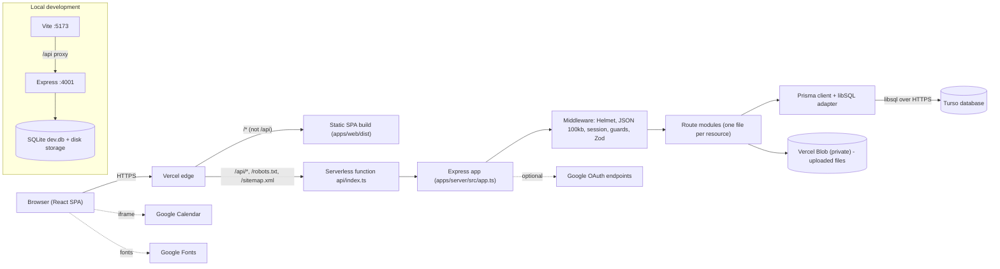
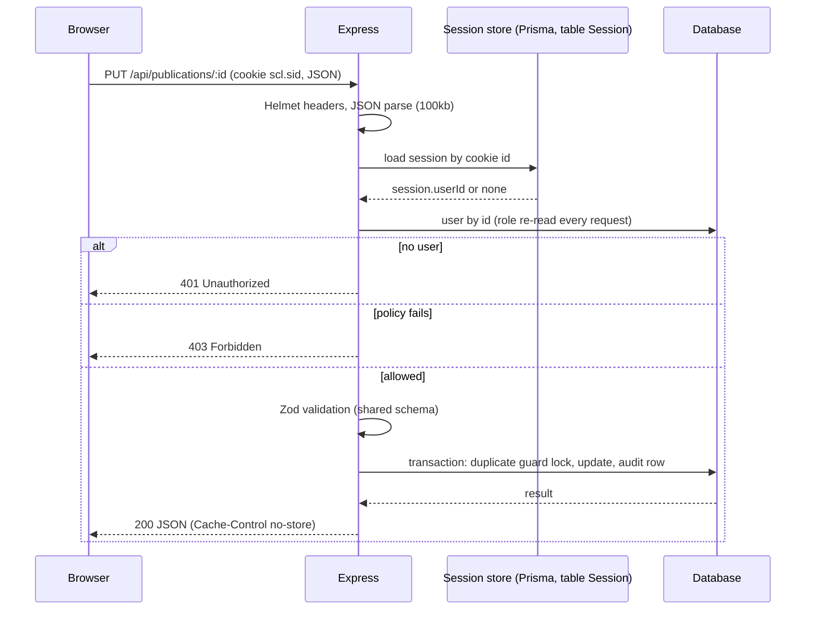
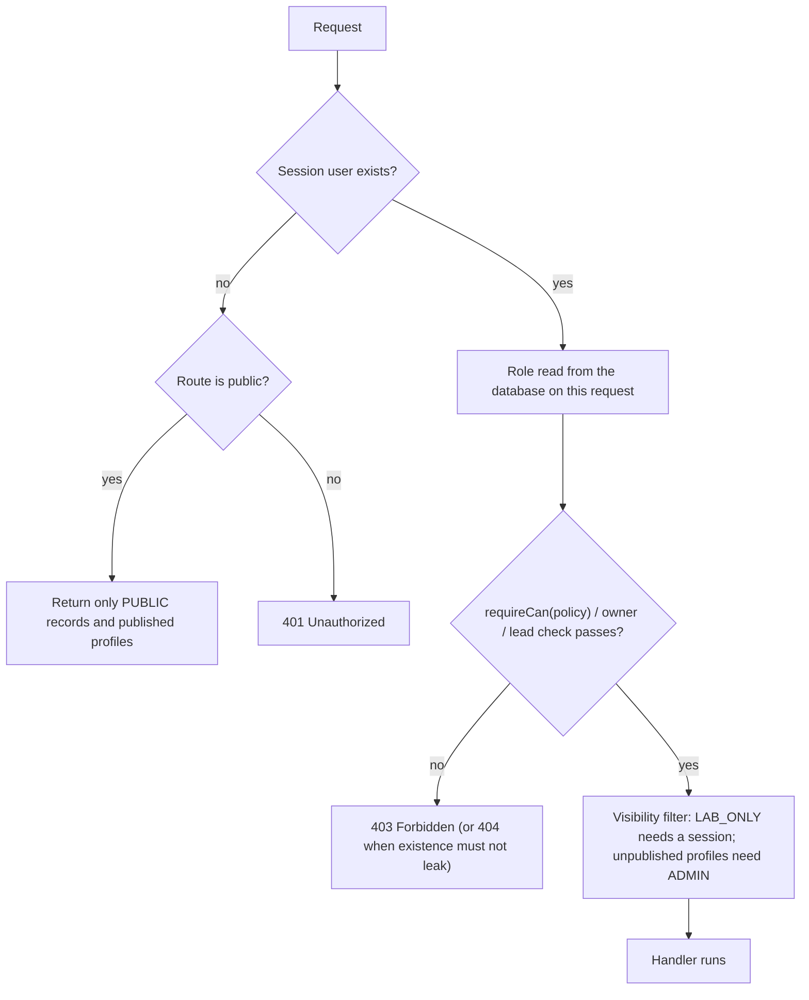
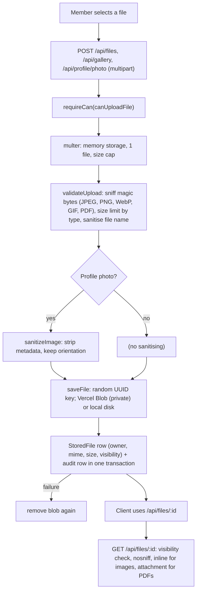
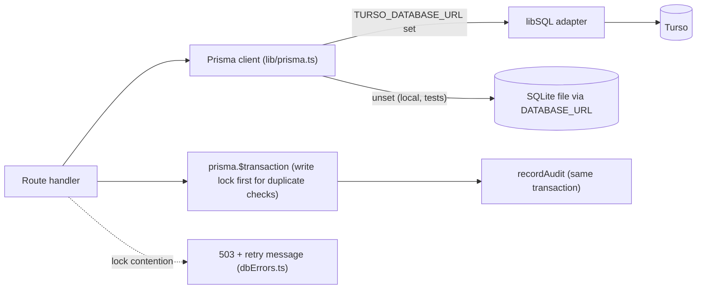

# 03. System architecture

All diagrams were drawn from the code, with file references. Where a box is a platform (Vercel, Turso) its internals are not verified here.

## Request lifecycle in words
1. The browser requests the site. Vercel serves the prebuilt single-page app (`apps/web/dist`) for any non-API path (`vercel.json` rewrites).
2. React renders and `AuthContext` calls `GET /api/auth/me` to learn who the visitor is. Pages call `apiFetch` (`apps/web/src/lib/api.ts`), a thin `fetch` wrapper that adds the JSON content type and an `X-Locale` header.
3. Requests to `/api/*` reach one Vercel serverless function (`api/index.ts`) that wraps the Express app (`apps/server/src/app.ts`).
4. Express applies, in order: trusted-proxy setting (`app.ts:24`), Helmet headers (`:25`), JSON body parser capped at 100 kb (`:15`, `:26`), the session middleware (`:27`).
5. The router (`routes/index.ts`) picks the route file. Each route is guarded by `optionalAuth`, `requireAuth`, `requireCan(policy)` or an owner/lead guard (`middleware/auth.ts`). Guards reload the user from the database on every request (`auth.ts:11-24`).
6. Input is validated with Zod schemas shared with the web app (`parseOrThrow`).
7. Handlers use Prisma for data, often inside transactions, and write audit rows.
8. Errors go to one handler (`app.ts:52-82`): known validation/HTTP errors with their message, body-parser and multer errors as 4xx, known database errors mapped, everything else a generic 500 (and the error is logged).
9. The JSON response returns (`Cache-Control: no-store` by default, `app.ts:42-47`) and React renders it.

## Diagram 1: overall system architecture


## Diagram 2: typical API request lifecycle


## Diagram 3: login and session lifecycle
```mermaid
sequenceDiagram
  participant U as Browser
  participant A as POST /api/auth/login
  participant RL as In-memory rate limiter
  participant DB as Database
  U->>A: email, password
  A->>RL: limited for (ip, email)? (10 failures / 15 min)
  alt limited
    A-->>U: 429
  else
    A->>DB: find user by lower-cased email
    A->>A: bcrypt.compare against real hash or dummy hash
    alt wrong
      A->>RL: record failure
      A-->>U: 401 "Incorrect email or password."
    else ok
      A->>RL: clear counter
      A->>A: session.regenerate() (new id)
      A->>DB: store session (userId, 7-day sliding expiry)
      A-->>U: 200 + Set-Cookie scl.sid (HttpOnly, SameSite=Lax, Secure in production)
    end
  end
  U->>A: POST /api/auth/logout
  A->>DB: delete session row; clear cookie
```

## Diagram 4: Google OAuth (optional; only for accounts already linked)
```mermaid
sequenceDiagram
  participant U as Browser
  participant S as /api/auth/google/start
  participant G as Google
  participant C as /api/auth/google/callback
  participant DB as Database
  U->>S: GET start (rate limited per IP)
  S->>DB: save state + nonce + PKCE verifier in the session row (short-lived)
  S-->>U: 302 to Google (state, nonce, code_challenge)
  U->>G: sign in
  G-->>U: 302 to callback ?code&state
  U->>C: GET callback
  C->>DB: consume the stored transaction atomically (single use)
  C->>C: state compared with timingSafeEqual
  C->>G: exchange code with PKCE verifier
  C->>C: verify ID token (audience, nonce) via google-auth-library
  C->>DB: find OAuthIdentity by (provider, subject)
  alt not linked
    C-->>U: 302 to login with "not linked" (no user is ever created)
  else linked
    C->>C: session.regenerate(); set userId
    C-->>U: 302 to the signed-in page
  end
```
Linking is a separate flow started by an already signed-in user after re-entering their password (`POST /api/auth/google/link/start`, same-origin check, `googleAuth.routes.ts:220-260`).

## Diagram 5: role-based authorization

Policy source: `packages/shared/src/permissions.ts`; guards: `apps/server/src/middleware/auth.ts:36-151`.

## Diagram 6: file upload lifecycle

Evidence: `routes/files.routes.ts:35-128`, `lib/fileService.ts:30-85`, `lib/storage.ts:111-127`, `routes/profile.routes.ts:128`.

## Diagram 7: database interaction


## Environment-specific configuration
`assertProductionConfig()` (`lib/config.ts:43`, called from `api/index.ts`) refuses to start production without the Turso pair, `SESSION_SECRET` and `TRUST_PROXY`. Local development uses `DATABASE_URL`, local disk storage and a development session secret with a warning (`lib/session.ts:13-21`). Variable names and purposes: [../technical/deployment.md](../technical/deployment.md).

## Deployment architecture
See [10-deployment-and-devops.md](10-deployment-and-devops.md). Preview and production isolation of data is **UNKNOWN** (Vercel dashboard).
