# 08. Database architecture

## Engine, hosting, access
- **Prisma 5.22** with `provider = "sqlite"` (`apps/server/prisma/schema.prisma`). Local development and all tests use a SQLite file (`DATABASE_URL`). **Production uses Turso (hosted libSQL)** through `@prisma/adapter-libsql` when `TURSO_DATABASE_URL` is set; `lib/prisma.ts` is the single place the client is created.
- **Access control at the database:** the application connects with one Turso auth token; there are no per-role database users. Authorization is entirely in the application (doc 06). Token storage: Vercel environment variables (names only in the repository). **Database-level access control and token rotation practice: Unknown.**
- **Parameterisation:** all queries use Prisma; one raw statement uses a bound parameter (`lib/googleOAuth.ts:105`).
- **Connection management:** serverless functions open a client per instance; local tests use `connection_limit=1` in one suite (`transaction-client` test). Connection limits and pooling on Turso: **Unknown**.
- **Production versus preview separation:** **Unknown** (Vercel scoping; finding F-22).

## Models (38) and what they store
| Area | Models |
|---|---|
| Accounts and sessions | `User` (email unique, `passwordHash`, `role`), `Session` (`id`, `data`, `expiresAt`, indexed by expiry), `AccountInvitation` (token hash), `OAuthIdentity` (`provider`, `subject`, unique pairs) |
| People | `TeamMember` (`category`, `isPublished`, research links, `userId` unique nullable), `HistoryEntry` |
| Research | `ResearchArea`, `ResearchGroup`, `ResearchProject`, `GroupMember`, `ProjectMember`, `ProjectArea`, `ProjectPublication`, `ResearcherArea` |
| Publications and news | `Publication` (+8 metadata columns), `PublicationAuthor`, `NewsItem`, `NewsAuthor` |
| Knowledge and resources | `KnowledgeDoc`, `LabResource`, `ResourceProject`, `Event` |
| Files | `StoredFile` (key, name, MIME, size, owner, visibility, `deletedAt`), `GalleryItem`, `GalleryImage`, `GalleryUploadAttempt` |
| Community | `ForumCategory`, `ForumPost`, `ForumPostRevision`, `ForumComment`, `ForumReaction`, `ForumMention` |
| Messaging | `Conversation`, `ConversationParticipant`, `Message`, `Notification` |
| Platform | `AuditLog`, `Translation` |

How requested items are stored: **users** `User`; **roles** `User.role` as a string validated on read (an unknown value is treated as MEMBER, `auth.ts:21-22`); **sessions** `Session.data` JSON; **alumni** `TeamMember` with `category = ALUMNI` and `isPublished`; **publications** `Publication` plus author links; **gallery** `GalleryItem`/`GalleryImage` pointing at `StoredFile`; **file metadata** `StoredFile`; the bytes live in storage, not the database.

## Constraints, indexes, cascades (VERIFIED by counting `schema.prisma`)
68 `@@index` declarations, 20 `@unique`/`@@unique` declarations. Relation delete rules: 36 `Cascade`, 27 `SetNull`, 1 `Restrict`. Highlights: deleting a `User` keeps the `TeamMember` (`SetNull`), keeps content authored (owner becomes null), deletes the user's reactions, notifications and conversation memberships (`Cascade`), and sets message senders and audit actors to null. Deleting a `TeamMember` cascades to history and to authorship, membership and area links, but not to the publications or news themselves. `ForumCategory` deletion is restricted while posts exist.

## Entity relationship diagram (generated from the schema; only foreign-key relations, with delete rule)

```mermaid
erDiagram
    TeamMember |o--o| User : "user (SetNull)"
    AccountInvitation }o--|| User : "invitedBy (Cascade)"
    OAuthIdentity }o--|| User : "user (Cascade)"
    HistoryEntry }o--|| TeamMember : "teamMember (Cascade)"
    NewsItem }o--o| ResearchProject : "project (SetNull)"
    PublicationAuthor }o--|| Publication : "publication (Cascade)"
    PublicationAuthor }o--|| TeamMember : "teamMember (Cascade)"
    NewsAuthor }o--|| NewsItem : "newsItem (Cascade)"
    NewsAuthor }o--|| TeamMember : "teamMember (Cascade)"
    GroupMember }o--|| ResearchGroup : "group (Cascade)"
    GroupMember }o--|| TeamMember : "teamMember (Cascade)"
    ResearchProject }o--o| ResearchGroup : "group (SetNull)"
    ProjectMember }o--|| ResearchProject : "project (Cascade)"
    ProjectMember }o--|| TeamMember : "teamMember (Cascade)"
    ProjectArea }o--|| ResearchProject : "project (Cascade)"
    ProjectArea }o--|| ResearchArea : "researchArea (Cascade)"
    ProjectPublication }o--|| ResearchProject : "project (Cascade)"
    ProjectPublication }o--|| Publication : "publication (Cascade)"
    ResearcherArea }o--|| TeamMember : "teamMember (Cascade)"
    ResearcherArea }o--|| ResearchArea : "researchArea (Cascade)"
    Event }o--o| ResearchProject : "project (SetNull)"
    Event }o--o| User : "createdBy (SetNull)"
    KnowledgeDoc }o--o| User : "author (SetNull)"
    KnowledgeDoc }o--o| ResearchProject : "project (SetNull)"
    KnowledgeDoc }o--o| ResearchArea : "researchArea (SetNull)"
    KnowledgeDoc }o--o| ResearchGroup : "group (SetNull)"
    KnowledgeDoc }o--o| TeamMember : "teamMember (SetNull)"
    LabResource }o--o| User : "owner (SetNull)"
    LabResource }o--o| ResearchArea : "researchArea (SetNull)"
    LabResource }o--o| ResearchGroup : "group (SetNull)"
    LabResource }o--o| KnowledgeDoc : "knowledgeDoc (SetNull)"
    LabResource }o--o| Publication : "publication (SetNull)"
    LabResource }o--o| Event : "event (SetNull)"
    LabResource }o--o| TeamMember : "teamMember (SetNull)"
    ResourceProject }o--|| LabResource : "resource (Cascade)"
    ResourceProject }o--|| ResearchProject : "project (Cascade)"
    StoredFile }o--o| User : "owner (SetNull)"
    GalleryItem |o--o| StoredFile : "file (Cascade)"
    GalleryItem }o--o| Event : "event (SetNull)"
    GalleryItem }o--o| ResearchProject : "project (SetNull)"
    GalleryImage }o--|| GalleryItem : "item (Cascade)"
    GalleryImage |o--o| StoredFile : "file (Cascade)"
    GalleryUploadAttempt }o--|| User : "user (Cascade)"
    ForumPost }o--|| ForumCategory : "category (Restrict)"
    ForumPost }o--o| User : "author (SetNull)"
    ForumPost }o--o| ResearchProject : "project (SetNull)"
    ForumPostRevision }o--|| ForumPost : "post (Cascade)"
    ForumPostRevision }o--o| User : "editor (SetNull)"
    ForumComment }o--|| ForumPost : "post (Cascade)"
    ForumComment }o--o| User : "author (SetNull)"
    ForumComment }o--o| ForumComment : "parent (Cascade)"
    ForumReaction }o--|| User : "user (Cascade)"
    ForumReaction }o--o| ForumPost : "post (Cascade)"
    ForumReaction }o--o| ForumComment : "comment (Cascade)"
    ForumMention }o--|| User : "mentionedUser (Cascade)"
    ForumMention }o--o| ForumPost : "post (Cascade)"
    ForumMention }o--o| ForumComment : "comment (Cascade)"
    ConversationParticipant }o--|| Conversation : "conversation (Cascade)"
    ConversationParticipant }o--|| User : "user (Cascade)"
    Message }o--|| Conversation : "conversation (Cascade)"
    Message }o--o| User : "sender (SetNull)"
    Notification }o--|| User : "user (Cascade)"
    Notification }o--o| User : "actor (SetNull)"
    AuditLog }o--o| User : "actor (SetNull)"
```

(`|o--o|` one-to-one, `}o--||` many-to-one required, `}o--o|` many-to-one optional.)

## Validation
Zod schemas in `packages/shared` validate every write (lengths, enums, URL schemes, dates, page ranges). The database stores plain strings for enums (SQLite has no enum type); correctness of values like `visibility`, `role`, `status` therefore rests on the application layer. A direct database edit could store an invalid value; reads defend against unknown roles and unknown publication status.

## Migration strategy
Prisma migration files (11) are additive. Local: `prisma migrate deploy`. **Production: the reviewed Turso executor** (`apps/server/scripts/turso-migrate.ts`): only SHA-256-pinned migrations, only additive statement forms, refuses partial or divergent states, inspect-only unless `--apply` with a stated recovery point (`lib/tursoMigrate.ts`). Vercel's build does not run migrations. Order matters: migrate first, deploy code second (the generated client names every column). Details: [../technical/database.md](../technical/database.md).

## Backup and recovery
No backup automation is in the repository. Recovery relies on Turso point-in-time recovery (DOCUMENTED ONLY; plan and retention **Unknown**) or a copy taken before a change. A restore has never been demonstrated in the repository. See F-17 and doc 12.

## Risks
| Risk | Assessment |
|---|---|
| Data loss | depends entirely on Turso's backups; no independent copy is automated |
| Inconsistent records | transactions and conflict mapping reduce races; no optimistic concurrency (F-15); enum-like strings are not constrained in SQL |
| Missing indexes | 68 indexes declared; query plans were not analysed (**Unknown**); `LIKE '%term%'` search cannot use indexes |
| Migration failure | executor refuses partial or divergent states; a failed apply needs a documented manual repair or point-in-time restore |
| Database outage | every API route fails with errors; the static SPA still loads (doc 12) |
| Single writer | SQLite semantics: write contention is mapped to a 503 with retry, not queued |
