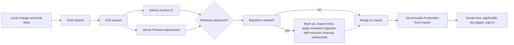

# 10. Deployment and DevOps

## Platform and why (assessment)
Hosting is **Vercel** (project `smart-computing-lab`, Git integration; the GitHub commit status "Vercel" links to it). The repository supports this with `vercel.json` and a serverless entry point `api/index.ts`. A static SPA plus an API function fits Vercel with no server to maintain, gives per-branch previews, and keeps cost near zero for a lab. The cost is serverless constraints (cold starts, per-instance memory, 4.5 MB body cap, no persistent disk) which shaped several design choices (Blob, Turso, in-memory limiters). The original rationale is documented in `docs/architecture/phase26-…` and the adapter note; the reasons above are an engineering assessment.

## Configuration (VERIFIED)
- `vercel.json`: build command builds `packages/shared` and `apps/web`; output `apps/web/dist`; the function includes the Prisma query-engine binary for Amazon Linux; rewrites send `/api/*`, `/robots.txt`, `/sitemap.xml` to the function and everything else to `index.html`. No `headers` are configured (F-04).
- Environment variables are set in the Vercel dashboard; names and purposes are in [../technical/deployment.md](../technical/deployment.md). `assertProductionConfig()` fails fast on missing production settings.
- **Production branch:** `master`. Merging deploys to Production automatically (a GitHub "Production" deployment appears for the merge commit). Pull-request branches get **Preview** deployments (observed). Whether Preview shares the production database is **Unknown** (F-22).

## CI/CD
GitHub Actions workflow `CI` (`.github/workflows/ci.yml`): runs on every pull request and push to `master`; Node 22; `npm ci`, build (shared, server, web with TypeScript), lint (web), create a throwaway SQLite database, unit chain, then nine fast database suites. Least privilege (`contents: read`), actions pinned to commit SHAs, no secrets, cancel-superseded concurrency, 15-minute timeout. It does not deploy. It is **not enforced** by branch protection (F-07).

## From a code change to production

## What happens if (VERIFIED where noted)
| Situation | Behavior |
|---|---|
| Build fails | CI fails on the PR (not required to merge, F-07). On `master`, Vercel keeps serving the previous successful deployment; the failed deployment does not go live |
| Deployment fails | same: the previous production deployment remains (platform behavior, DOCUMENTED ONLY) |
| Migration fails | executor refuses partial/divergent states and prints recovery guidance; manual repair or point-in-time restore (`docs/architecture/turso-migration-executor.md`) |
| Schema and code out of order | code deployed before its migration fails with "no such column" on every page that loads the table (this happened with publication metadata and was fixed by applying the migration) |
| Deployment introduces a bug | roll back by promoting the previous deployment in Vercel (platform capability, not exercised in the repository); additive migrations make older code safe |
| Production unavailable | the platform's status applies; the repository has no second region or failover |
| Preview misconfigured | could run unreviewed code against production data if variables are shared (F-22) |

## Logs, monitoring, health
Runtime logs are Vercel function logs from `console.*` calls. No error tracker, uptime monitor or alerting is configured in code. `GET /api/health` returns `{"status":"ok"}` without touching the database (`app.ts:29`), so it proves the function runs, not that the database works.

## Rollback and recovery
Application: redeploy an earlier deployment. Database: columns are treated as permanent; the executor refuses `DROP`; point-in-time recovery only for real incidents. Files: not covered by database recovery.
